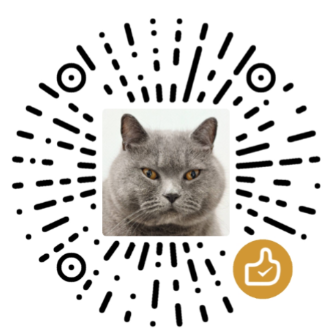

# MoryPaste

**手机截图发到电脑，直接 Ctrl+V。**

MoryPaste 通过局域网把 Android 手机上的图片、视频和文件发送到 Windows。配对后，从手机的系统分享菜单选择「发送到电脑」，确认目标即可发送。Android 与 Windows 也可以双向传送剪贴板文字。

## 下载

| 平台 | 下载入口 |
| --- | --- |
| Windows | [下载最新安装包](https://github.com/xiaodeng2025/MoryPaste/releases/latest) |
| Android | [下载正式版 APK](https://github.com/xiaodeng2025/MoryPaste/releases/tag/android-v0.5.11) |

Windows 安装包目前未签名，开启智能应用控制的电脑可能遇到 [安装拦截（错误 4551）](https://github.com/xiaodeng2025/MoryPaste/issues/5)。

## 三步上手

1. 安装 Windows 和 Android 两端，让它们连到同一局域网。
2. 在电脑上点「添加手机」。如出现 Windows 授权提示，确认后用手机 App 扫描配对码。
3. 在相册、截图或文件管理器里点分享，选「发送到电脑」，再确认目标。

## 双向剪贴板文字

需要 Windows 0.6.12 和 Android 0.5.10 或更新版本。两端先扫码配对，并连到同一局域网。

- **电脑到手机**：在手机开启接收后，电脑复制的文字会自动传到手机，可直接粘贴。
- **手机到电脑**：在手机复制文字后，用已配对的电脑卡片、桌面快捷图标或系统下拉面板一键发送，再在电脑粘贴。

## 接收后怎么用

- **图片**保存到电脑并写入剪贴板，可以在支持图片粘贴的应用里按 `Ctrl+V`。
- **视频和文件**按类型保存。电脑首页的「打开接收目录」可以查看收到的内容。

## 版本与支持

- [所有发布版本](https://github.com/xiaodeng2025/MoryPaste/releases) · [版本记录](CHANGELOG.md) · [升级与回退](RELEASING.md)
- [提交问题或建议](https://github.com/xiaodeng2025/MoryPaste/issues) · 联系邮箱 `hermesdesktop@agent.qq.com`

此仓库包含 Windows 和 Android 客户端源码、安装包、更新记录和问题反馈。

## 源码与构建

- [Windows 客户端和接收核心](windows/)
- [Android 客户端](android/)
- [双端构建说明](BUILDING.md)
- [GPL-3.0 许可证](LICENSE)

第三方组件各自适用原许可证。官方安装包请从上面的下载入口获取。

## 支持项目

如果 MoryPaste 对你有帮助，欢迎用微信扫码打赏，支持后续维护。

